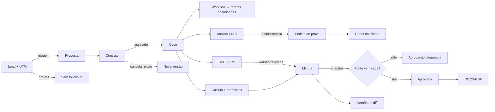

# 03 — Arquitetura unificada

O **caso** (`Case`) continua sendo o eixo. Cada módulo novo grava a entidade com `organizationId`, `caseId` e versão, e aparece numa aba da ficha do caso.

| Entidade | Coleção | Novo? | Ligação | Tela |
|---|---|---|---|---|
| `Calculation` | `calculations` | existente (+modelos) | `caseId` opcional, escolhido na criação ou no detalhe | `/app/calculos`, aba Cálculos do caso |
| `PensionAnalysis` | `pensionAnalyses` | existente | `caseId` | análise + diagnóstico CNIS |
| `Assessment` (bpc, ppp) | `assessments` | **novo** | `caseId`, `clientId` | `/app/previdenciario/especializadas/[id]`, aba Análises |
| `LegalSource` | `legalSources` | **novo** | por escritório, `caseId` opcional | painel Fontes da minuta |
| `LegalDraft.versions` | `drafts` | campo opcional novo | — | painel Versões |
| `Lead.optOutAt/followUps` | `leads` | campos opcionais novos | — | painel Follow-up |
| `Task` (workflow) | `tasks` | existente (`dependsOn`) | `caseId`, id determinístico | `/app/workflows`, Tarefas |
| `DocumentItem` (solicitado) | `documents` | existente | `caseId`, `clientId` | portal do cliente |

## Domínio puro (testável, sem UI)
`calc-engine.ts` · `cnis.ts` · `citations.ts` · `text-diff.ts` · `workflows.ts` · `followup.ts`

## Fluxos

## Adaptadores (fase 2)
`IndexSourceAdapter` (novo), `LegalDataAdapter`, `AIProviderAdapter`, `PaymentProviderAdapter`, `SignatureAdapter`, `MessagingAdapter`, `EmailAdapter`, `ObjectStorageAdapter`, mais as informações de Jusbrasil e Meta/Google Ads. Todos ficam em `planned`, `demo` ou `requires_credentials`, e um teste impede o modo real.
